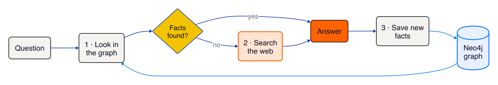

# Stop Your Agent from Searching the Web for the Same Thing Twice: Tavily + a Neo4j Knowledge Graph on Amazon Bedrock AgentCore

[](LICENSE)
[](https://python.org)
[](https://github.com/strands-agents/sdk-python)
[](https://aws.amazon.com/bedrock/agentcore/?trk=87c4c426-cddf-4799-a299-273337552ad8&sc_channel=el)
[](https://neo4j.com/)

A web-research agent forgets everything it read as soon as it answers. Ask a related question tomorrow and it pays for the same searches again. Ask a question that combines two earlier answers and it searches twice more. These demos give the agent a Neo4j knowledge graph: it stores each fact it reads with the page it came from, checks the graph before searching, and walks from fact to fact to answer questions no single search returned.

Built for the talk *AWS AgentCore and Tavily* at the Graphs for Engineering meetup (Part 2). The agent uses [Strands Agents](https://github.com/strands-agents/sdk-python) and [Tavily](https://docs.tavily.com/) for web search.

---

## Demos

| Demo | Description | Stack |
|------|-------------|-------|
| [01 - Local graph agent](01-local-graph-agent/) | A Strands agent with Tavily (MCP) and a Neo4j knowledge graph as its `MemoryManager` store, in a notebook. A second session with a new agent answers from the graph without searching; an agent without the graph searches again. |   |
| [02 - AgentCore Runtime V2](02-agentcore-runtime-v2/) | Put the same agent in production: AgentCore Runtime (platform version V2, code package, no container), Tavily through AgentCore Gateway with the key in AgentCore Identity, and the graph in Neo4j AuraDB. Deploy it step by step with a boto3 notebook or an AWS CLI notebook, or in one command with the AWS CDK. |    |

`web_facts_store.py` is the same file in both demos, and the `Agent(...)` call is the same; a test in Demo 02 fails if they drift.

---

## Why a graph and not a cache?

| Question | Search cache (key-value or vector) | Knowledge graph |
|----------|------------------------------------|-----------------|
| The same question again | hit | hit |
| The same question in other words | vector cache: maybe | hit, if the entities match |
| A question that combines two earlier answers | miss | answered by walking the facts |
| "Where did this fact come from?" | not stored | every fact points to its source page |

If your agent only repeats identical questions, a cache is simpler and you should use one. The graph pays off when questions build on each other.

## How does the agent use the graph?



```
user question ─▶ MemoryManager.search(question) ─▶ <memory> facts injected into the prompt
                                                     │ enough?  yes ─▶ answer, citing stored sources
                                                     │          no  ─▶ Tavily (MCP) ─▶ answer
after the turn ─▶ ModelExtractor (agent's model) ─▶ WebFactsGraph.add(fact, subject/predicate/object/source_url)
```

```
(:WebFact {statement, predicate})-[:SUBJECT]->(:WebEntity)      (:WebFact)-[:OBJECT]->(:WebEntity)      (:WebFact)-[:FROM]->(:WebSource {url})
```

`WebFactsGraph` is also a Strands hook: it records the URLs Tavily returned, and `add()` drops a fact whose URL is not one of them, so a citation the model invented never reaches the graph.

## Two principles across the demos

**The control lives in the agent's harness.** Tavily is an [MCP tool](https://strandsagents.com/docs/user-guide/sdk/tools/mcp-tools/?trk=87c4c426-cddf-4799-a299-273337552ad8&sc_channel=el), the graph is a [MemoryManager store](https://strandsagents.com/docs/user-guide/sdk/memory/managing-memory/?trk=87c4c426-cddf-4799-a299-273337552ad8&sc_channel=el) and a [hook](https://strandsagents.com/docs/user-guide/sdk/agents/hooks/?trk=87c4c426-cddf-4799-a299-273337552ad8&sc_channel=el). No Python loop around the agent decides what to search or store.

**Deterministic vs model-based.** Graph writes, recall queries and the URL and name checks are deterministic, and `pytest` covers them without AWS or a model. Whether the agent searches and which facts the extractor returns are model inference; the search counts change from run to run ([Enabling Determinism in LLM Inference](https://arxiv.org/abs/2601.17768), 2026).

## Prerequisites

- Python 3.10+, [uv](https://docs.astral.sh/uv/)
- Demo 01: `OPENAI_API_KEY`. Demo 02: AWS credentials with access to a Bedrock model (default: Claude Sonnet 4.5)
- A [Tavily API key](https://app.tavily.com/home) (`TAVILY_API_KEY` or `TAVILY_KEY`)
- Neo4j: local (`scripts/setup_local_neo4j.sh`, no Docker) for Demo 01, [Neo4j AuraDB](https://neo4j.com/cloud/platform/aura-graph-database/) for Demo 02
- Demo 02 only: permission to create IAM roles, Secrets Manager secrets, an S3 bucket and AgentCore resources; `uv` and `zip` to build the package (no Docker); and one of boto3 `>= 1.43.95`, AWS CLI v2 `>= 2.36.46` or the AWS CDK CLI

## Security notes

- Demo 01 reads the Tavily key from your shell and sends it in a header to Tavily's MCP server; `.env` (never committed) holds only Neo4j settings. Demo 02 takes the Tavily key and the AuraDB credentials from your shell and stores them in AgentCore Identity and Secrets Manager (the notebooks, or `cdk/deploy.sh`); no template or notebook cell holds a secret value, and printed output hides the account ID.
- The Gateway uses IAM inbound auth: only principals with `bedrock-agentcore:InvokeGateway` on it can call Tavily through it. The runtime uses IAM too: callers need `bedrock-agentcore:InvokeAgentRuntime`.
- The graph keeps the questions' entities and the pages they led to. Scope it per tenant in a multi-user system.

## Pricing

| Service | Used for | Pricing |
|---------|----------|---------|
| OpenAI | The local agent's model (Demo 01) | [OpenAI pricing](https://openai.com/api/pricing/) |
| Amazon Bedrock | The agent's model on AgentCore (Demo 02) | [Bedrock pricing](https://aws.amazon.com/bedrock/pricing/?trk=87c4c426-cddf-4799-a299-273337552ad8&sc_channel=el) |
| Amazon Bedrock AgentCore | Runtime and Gateway (Demo 02) | [AgentCore pricing](https://aws.amazon.com/bedrock/agentcore/pricing/?trk=87c4c426-cddf-4799-a299-273337552ad8&sc_channel=el) |
| AWS Secrets Manager | Two secrets (Demo 02) | [Secrets Manager pricing](https://aws.amazon.com/secrets-manager/pricing/?trk=87c4c426-cddf-4799-a299-273337552ad8&sc_channel=el) |
| Tavily | Search and extract calls | [Tavily pricing](https://www.tavily.com/pricing) |
| Neo4j | Free locally; AuraDB has a free tier and paid tiers | [Neo4j pricing](https://neo4j.com/pricing/) |

For an estimate before you commit spend, use the [AWS Pricing Calculator](https://calculator.aws/?trk=87c4c426-cddf-4799-a299-273337552ad8&sc_channel=el).

## Cleanup

Demo 02: the last section of the notebook you used (guarded by `CONFIRM_DELETE`), or `02-agentcore-runtime-v2/cdk/destroy.sh` (stack and secrets). Your AuraDB instance is not touched. Local Neo4j: `scripts/setup_local_neo4j.sh stop`, and delete `~/neo4j-instances/tavily-provenance` to remove its data.

## Reporting security issues

See [CONTRIBUTING](CONTRIBUTING.md#security-issue-notifications) for more information.

## License

This library is licensed under the MIT-0 License. See the [LICENSE](LICENSE) file.
