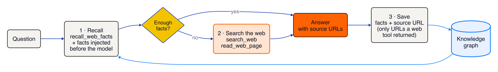
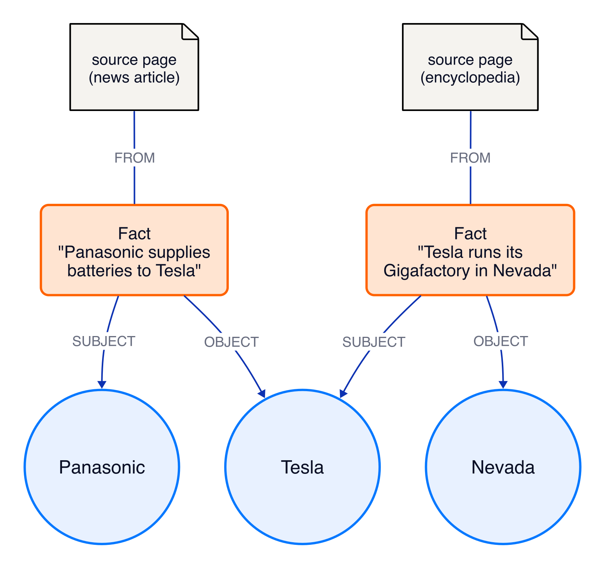
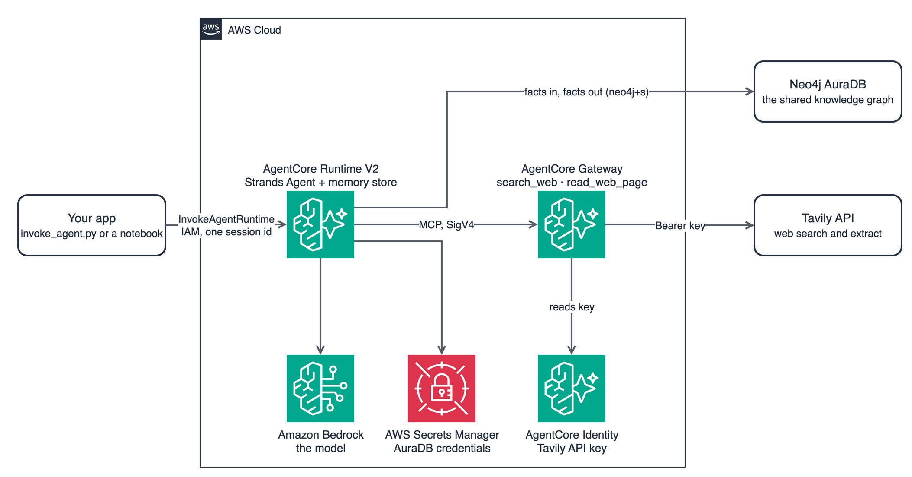

# Stop Your Agent from Searching the Web for the Same Thing Twice: Tavily + a Neo4j Knowledge Graph on Amazon Bedrock AgentCore

[](LICENSE)
[](https://python.org)
[](https://strandsagents.com/?trk=87c4c426-cddf-4799-a299-273337552ad8&sc_channel=el)
[](https://aws.amazon.com/bedrock/agentcore/?trk=87c4c426-cddf-4799-a299-273337552ad8&sc_channel=el)
[](https://neo4j.com/)

A research agent with web search forgets every page it read once it answers, so a related question in a new conversation pays for the same searches again. This sample gives a [Strands Agents](https://strandsagents.com/?trk=87c4c426-cddf-4799-a299-273337552ad8&sc_channel=el) agent a knowledge graph as its memory: it keeps each fact it reads with the page it came from, looks in the graph before searching, and searches the web only for what is missing. Then the same agent runs on Amazon Bedrock AgentCore.

This sample works with Amazon Bedrock AgentCore.

> Code in this repository is provided "as is", and is not officially supported by Amazon.

---

## What is in this repository?

| Demo | What it shows | Stack |
|------|---------------|-------|
| [01 - Local graph agent](01-local-graph-agent/) | The whole agent in one notebook: web tools, a Neo4j memory store, two sessions. A new session answers from the graph without searching; an agent without the graph searches again. |    |
| [02 - AgentCore Runtime V2](02-agentcore-runtime-v2/) | The same agent in production: AgentCore Runtime (platform version V2, code package, no container), the web tools through AgentCore Gateway with the Tavily key in AgentCore Identity, the graph in Neo4j AuraDB. Deploy with a boto3 notebook, an AWS CLI notebook or the AWS CDK, then test sessions and memory with a notebook. |    |

The memory store (`web_facts_store.py`), the tools the model sees and the `Agent(...)` call are the same in both demos. Tests in Demo 02 fail if they drift.

## What happens on each turn?

The agent looks in its memory first, searches the web only when memory does not hold enough, and saves what it read after it answers.



| Step | Strands piece | What it does |
|------|---------------|--------------|
| 1. Recall | [`MemoryManager`](https://strandsagents.com/docs/user-guide/sdk/memory/managing-memory/?trk=87c4c426-cddf-4799-a299-273337552ad8&sc_channel=el) | Before each model call it searches the graph with the question and adds the matching facts to the prompt. It also gives the model the `recall_web_facts` tool for follow-ups ("which of those are Korean?"). |
| 2. Search | [`@tool`](https://strandsagents.com/docs/user-guide/sdk/tools/custom-tools/?trk=87c4c426-cddf-4799-a299-273337552ad8&sc_channel=el) `search_web`, `read_web_page` | Tavily's search and extract APIs. Each tool's description tells the model when to use it and when not. |
| 3. Save | `ModelExtractor` + [hook](https://strandsagents.com/docs/user-guide/sdk/agents/hooks/?trk=87c4c426-cddf-4799-a299-273337552ad8&sc_channel=el) | After the turn, the agent's own model turns the answer into facts. The store keeps a fact only if its source URL is one a web tool returned, so an invented citation never reaches the graph. |

No Python loop around the agent decides what to search or store: everything above is configuration of the Strands harness.

## How is a fact stored?

Each fact is one sentence that links two named things and points to the page it came from. Two facts that mention the same thing share its node, and that shared node is how the agent answers a question that combines two earlier answers.



In Neo4j the labels are `WebFact`, `WebEntity` and `WebSource`, so the store can share a database with other data; `clear()` deletes only these labels.

## Isn't this just a cache?

In one way, yes: both skip a search you already paid for. They keep different things.

| | Cache | This knowledge graph |
|---|---|---|
| Keeps | Whole answers, keyed by the question | Facts, each with its source page, linked by name |
| Same question again | Hit | Hit |
| A new question that combines two earlier answers | Miss | Answered from the shared entities |
| "Where did this come from?" | Not kept | Every fact points to its page |
| Freshness | Usually a TTL | **None in this demo** |

**This is a demo.** Nothing in the graph expires, and the agent does not know when the web changed. For prices, news or anything that must be current, the agent should search again. Each fact keeps the time it was read (`at`), so a real system can set an age limit. If your agent only repeats the same questions, a cache is simpler and you should use one.

## What does it look like on AWS?



Three lines change from the local notebook; the `Agent(...)` call does not:

| | Demo 01 (local) | Demo 02 (AgentCore) |
|---|---|---|
| Model | `OpenAIModel` | `BedrockModel` |
| Web tools | two `@tool` functions on Tavily's API | the same two tools from [AgentCore Gateway](https://docs.aws.amazon.com/bedrock-agentcore/latest/devguide/gateway.html?trk=87c4c426-cddf-4799-a299-273337552ad8&sc_channel=el) (OpenAPI target, SigV4) |
| Neo4j | local instance or AuraDB, from `.env` | AuraDB, credentials from AWS Secrets Manager |

One runtime session id is one conversation: the same id keeps the history, a new id starts a new conversation that still shares the graph ([runtime sessions](https://docs.aws.amazon.com/bedrock-agentcore/latest/devguide/runtime-sessions.html?trk=87c4c426-cddf-4799-a299-273337552ad8&sc_channel=el)). The architecture diagram source is [`images/agentcore-tavily-neo4j-graph-agent-architecture.drawio`](images/agentcore-tavily-neo4j-graph-agent-architecture.drawio).

## What did the live runs show?

Questions are about EV batteries, factories and lithium. Counts are model behavior and change from run to run.

| Run | Session 1 (empty graph) | New session, "Who supplies the batteries in Tesla cars?" | Agent without the graph, same question |
|---|---|---|---|
| Local notebook (OpenAI `gpt-4o-mini`) | searched on each of 3 questions, 14 facts saved | **0 web searches** | 1 web search |
| AgentCore (Amazon Bedrock, Claude Sonnet 4.5) | searched on questions 1-3; the follow-ups "which of those are South Korean?" and "what was my first question?" used no tool | **answered from `recall_web_facts` only** | — |

For the Tesla question in a new session, the local run sent 1,125 input tokens with the graph and 2,737 without it, and the graph lookup took about 160 ms against a web search of 1.3-2.8 s. Saving facts costs one extra model call per turn (the extractor); an interval trigger instead of every turn lowers it.

## Why do the tool descriptions matter?

The model reads every tool's name, description and parameters on every call of the loop and decides from that text alone. So each description here says what the tool does, when to use it and when not, what each parameter means, what comes back, and its limits; none of them names the backend. The system prompt keeps only the role, the rule to cite a source URL for every fact, and the answer length. Guidance: Strands [Write effective tool descriptions](https://strandsagents.com/docs/user-guide/sdk/tools/custom-tools/?trk=87c4c426-cddf-4799-a299-273337552ad8&sc_channel=el) and the memory guide's [memory tools](https://strandsagents.com/docs/user-guide/sdk/memory/managing-memory/?trk=87c4c426-cddf-4799-a299-273337552ad8&sc_channel=el).

## What are the prerequisites?

- Python 3.10+ and [uv](https://docs.astral.sh/uv/)
- A [Tavily API key](https://app.tavily.com/home) in `TAVILY_API_KEY` (or `TAVILY_KEY`)
- Neo4j: a [Neo4j AuraDB](https://neo4j.com/product/auradb/) instance, or a local Neo4j Community instance started with `scripts/setup_local_neo4j.sh` (no Docker)
- Demo 01: `OPENAI_API_KEY`
- Demo 02: AWS credentials that can create IAM roles, Secrets Manager secrets, an S3 bucket and AgentCore resources, with access to an Amazon Bedrock model (default Claude Sonnet 4.5); `uv` and `zip` to build the code package; and boto3 `>= 1.43.95`, AWS CLI v2 `>= 2.36.46` or the AWS CDK CLI

## How do I run it?

```bash
# Demo 01: the local agent
cd 01-local-graph-agent
cp .env.example .env            # fill in your Neo4j connection
uv venv && uv pip install -r requirements.txt
# open test_local_graph_agent.ipynb in JupyterLab or VS Code and run it top to bottom

# Demo 02: the same agent on AgentCore (one of three paths)
cd ../02-agentcore-runtime-v2
set -a && source ../01-local-graph-agent/.env && set +a   # Neo4j values; TAVILY_API_KEY exported in your shell
cd cdk && ./deploy.sh           # or deploy_with_boto3.ipynb / deploy_with_cli.ipynb
# then open test_deployed_agent.ipynb: two sessions, one graph
```

Secrets come only from your environment. They are stored in AgentCore Identity (Tavily key) and Secrets Manager (AuraDB), never in a template, a notebook cell or printed output.

## What is in each folder?

| Path | Purpose |
|------|---------|
| `01-local-graph-agent/test_local_graph_agent.ipynb` | The agent, step by step: model, web tools, memory store, two sessions, the graph |
| `01-local-graph-agent/web_facts_store.py` | The Strands `MemoryStore` on Neo4j and the hook that records which URLs the web tools returned |
| `02-agentcore-runtime-v2/agent/research_agent.py` | The same agent with the three AgentCore changes marked |
| `02-agentcore-runtime-v2/schemas/tavily-openapi.json` | The Gateway's web tools, generated from the notebook's `@tool` functions by `scripts/sync_gateway_schema.py` |
| `02-agentcore-runtime-v2/deploy_with_boto3.ipynb`, `deploy_with_cli.ipynb`, `cdk/` | Three ways to create the same resources |
| `02-agentcore-runtime-v2/test_deployed_agent.ipynb` | Sessions and memory against the deployed agent |
| `images/` | Diagrams and their sources (`.d2`, `.drawio`) |

## How much does it cost?

| Service | Used for | Pricing |
|---------|----------|---------|
| Amazon Bedrock | The model on AgentCore | [Bedrock pricing](https://aws.amazon.com/bedrock/pricing/?trk=87c4c426-cddf-4799-a299-273337552ad8&sc_channel=el) |
| Amazon Bedrock AgentCore | Runtime, Gateway, Identity | [AgentCore pricing](https://aws.amazon.com/bedrock/agentcore/pricing/?trk=87c4c426-cddf-4799-a299-273337552ad8&sc_channel=el) |
| AWS Secrets Manager | The AuraDB credentials | [Secrets Manager pricing](https://aws.amazon.com/secrets-manager/pricing/?trk=87c4c426-cddf-4799-a299-273337552ad8&sc_channel=el) |
| Tavily | Search (1 credit, basic) and extract | [Tavily credits](https://docs.tavily.com/documentation/api-credits) |
| OpenAI | The local demo's model | [OpenAI pricing](https://openai.com/api/pricing/) |
| Neo4j | Local is free; AuraDB has free and paid tiers | [Neo4j pricing](https://neo4j.com/pricing/) |

Estimate before you deploy with the [AWS Pricing Calculator](https://calculator.aws/?trk=87c4c426-cddf-4799-a299-273337552ad8&sc_channel=el).

## How do I clean up?

Demo 02: `02-agentcore-runtime-v2/cdk/destroy.sh`, or the last section of the notebook you deployed with (guarded by `CONFIRM_DELETE`). Your AuraDB instance is not touched; the notebook's last cell deletes only the store's nodes. Local Neo4j: `scripts/setup_local_neo4j.sh stop`.

## FAQ

**Does it work without Neo4j?** The pattern does: any backend that implements the Strands `MemoryStore` contract (`search`, and `add` to be writable) plugs into the same `MemoryManager`. The graph is what lets a question hop from one fact to another through a shared entity.

**Why not use the Tavily MCP server directly?** Its tool descriptions tell the model to search before answering any factual question, and Strands cannot change an MCP server's descriptions. Owning the two tools lets their descriptions say when not to search, and keeps them identical locally and on AgentCore Gateway.

**Why AgentCore Gateway for Tavily?** The Tavily key stays in AgentCore Identity and never reaches the agent, and IAM decides who can call the tools.

**Does the graph mix users?** In this demo every session shares one graph. In a multi-user system, scope the store per tenant.

**Will the answers stay current?** No. See [Isn't this just a cache?](#isnt-this-just-a-cache): search again when the data must be current.

## References

- Strands Agents: [memory](https://strandsagents.com/docs/user-guide/sdk/memory/managing-memory/?trk=87c4c426-cddf-4799-a299-273337552ad8&sc_channel=el), [custom tools](https://strandsagents.com/docs/user-guide/sdk/tools/custom-tools/?trk=87c4c426-cddf-4799-a299-273337552ad8&sc_channel=el), [hooks](https://strandsagents.com/docs/user-guide/sdk/agents/hooks/?trk=87c4c426-cddf-4799-a299-273337552ad8&sc_channel=el)
- Amazon Bedrock AgentCore: [Runtime](https://docs.aws.amazon.com/bedrock-agentcore/latest/devguide/runtime-how-it-works.html?trk=87c4c426-cddf-4799-a299-273337552ad8&sc_channel=el), [Gateway OpenAPI targets](https://docs.aws.amazon.com/bedrock-agentcore/latest/devguide/gateway-schema-openapi.html?trk=87c4c426-cddf-4799-a299-273337552ad8&sc_channel=el), [Gateway integration templates (Tavily)](https://docs.aws.amazon.com/bedrock-agentcore/latest/devguide/gateway-target-integrations.html?trk=87c4c426-cddf-4799-a299-273337552ad8&sc_channel=el)
- [Tavily API](https://docs.tavily.com/), [Neo4j AuraDB](https://neo4j.com/product/auradb/)

## Contributing

Contributions are welcome! See [CONTRIBUTING](CONTRIBUTING.md) for more information.

## Security

If you discover a potential security issue in this project, notify AWS/Amazon Security via the [vulnerability reporting page](http://aws.amazon.com/security/vulnerability-reporting/). Please do **not** create a public GitHub issue.

## License

This library is licensed under the MIT-0 License. See the [LICENSE](LICENSE) file for details.
